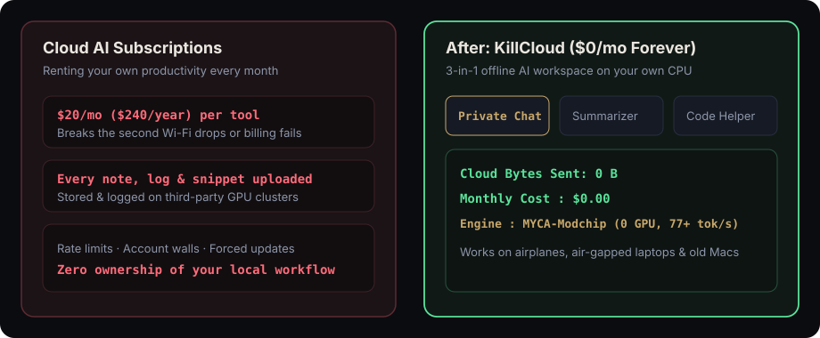

<div align="center">

# KillCloud

### Stop paying $20/month to send your private notes to someone else's GPU.

A sleek, **100% offline 3-in-1 AI workspace** (Private Chat, Note/Log Summarizer, Offline Code Helper) that runs on any laptop CPU with **0 bytes sent to the cloud** — powered by [MYCA-Modchip](https://github.com/brienteth/myca-ghr-modchip).

[](LICENSE)
[](#quick-start)
[](#quick-start)
[](#contributing)

<br/>



</div>

---

## Why KillCloud?

| | Cloud AI Tools | **KillCloud** |
| :--- | :---: | :---: |
| **Cost** | $20 / month ($240 / year) | **$0.00 forever (MIT)** |
| **Privacy** | Uploaded to external servers | **0 bytes leave your machine** |
| **Hardware** | Cloud GPU clusters | **Any CPU (0 GPU, 69 MB model)** |
| **Offline / Airplane** | Broken | **Works 100% offline at 77+ tok/s** |

---

## Quick Start (10 Seconds)

```bash
# 1. Install the 0-GPU runtime + 69 MB model (once)
curl -fsSL https://raw.githubusercontent.com/brienteth/myca-ghr-modchip/main/install.sh | sh
myca-modchip pull smollm2-135m

# 2. Launch KillCloud
git clone https://github.com/brienteth/killcloud.git
cd killcloud
python3 killcloud.py
```

Open **`http://127.0.0.1:8989/`**.

---

## Included Offline Modes
- **Private Chat:** Ask questions offline with zero accounts or telemetry.
- **Note / Doc Summarizer:** Paste sensitive meeting notes, emails, or server logs and summarize locally.
- **Offline Code Helper:** Explain C/Python/systems snippets on air-gapped machines.

---

## Contributing (PRs Welcome!)

Want to add new local workflows (PDF/Markdown reader, SQL helper, regex explainer, git commit writer)?
- Add a mode in `killcloud.py` (keep zero external `pip` dependencies)
- Open a PR!
